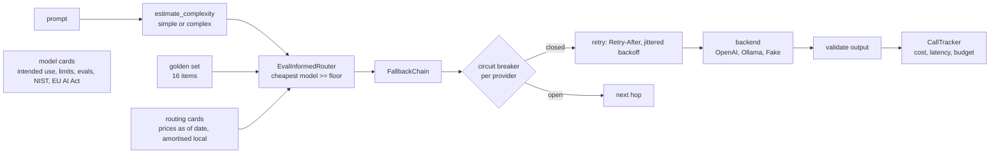

# Jagadish-model-inference-lab

[](https://github.com/jagadishmazure-jpg/Jagadish-model-inference-lab/actions/workflows/ci.yml)
[](https://github.com/jagadishmazure-jpg/Jagadish-model-inference-lab/actions/workflows/codeql.yml)


**Model routing done carefully: routing cards with dated prices, an amortised cost for local models, eval-informed routing on a quality floor, retries with backoff, circuit breakers and rate-limit handling in the fallback chain, budget tracking, and model cards with NIST AI RMF and EU AI Act notes.**

> Personal learning and portfolio project. Everything runs offline on synthetic,
> fictional data with no API keys. Nothing is deployed. Numbers in this README
> come from real runs and are re-checked by CI (`scripts/render_docs.py --check`).

## Recruiter summary

- Routes each prompt to the cheapest model that passes a quality floor on a golden set for its task class, and explains the choice with the cost and the price date.
- Real run: simple prompts go to llama-3.1-8b (0.89 at $0.000050 per reference call), complex ones to gpt-4o (1.00 at $0.000750); a rate-limited, then failing provider is retried with Retry-After and jittered backoff, its breaker opens, and the next call skips it.
- Local models are not priced at $0: the demo shows the same GPU at 5% utilisation costs $0.000500 per call, more than gpt-4o-mini at $0.000045. Eval scores are simulated and labelled so.

## Purpose

Most routing demos pick a model by a hard-coded rule and treat open models as
free. I wanted the version I would defend in a design review: prices with a
date and a source, an honest cost for self-hosting, a quality floor measured
per task class, and a fallback path that survives rate limits and outages
without hammering a failing provider. Hosted list prices were checked against
the provider's public page on the date in the routing cards.

## Architecture



## How it works

**Routing cards** (`inferlab/models.py`): name, weights, licence, context,
price per token, tiers, and whether the price is a vendor list price or an
amortised estimate (`LocalInfra`: GPU $/hour, throughput, utilisation).
`PRICES_AS_OF` dates every price. See [docs/routing-cards.md](docs/routing-cards.md).

**Routing** (`inferlab/router.py`): `PolicyRouter` has four static policies
(cheapest, balanced, quality, fastest). `EvalInformedRouter` uses golden-set
hit rates per task class from `inferlab/evals.py` and picks the cheapest
model at or above the floor (default 0.8). The `reason` field states the
class, floor, score and cost.

**Resilience** (`inferlab/resilience.py`, `inferlab/fallback.py`): typed
errors for rate limits (with `Retry-After`) and transient failures; a retry
policy with full jitter and a cap; a per-provider breaker (closed, open,
half-open); output validation before a hop counts as served. Programming
errors are not retried.

**Tracking and cards** (`inferlab/tracker.py`, `inferlab/model_cards.py`):
per-call cost and latency with a session budget, and model cards that
`validate()` checks for required fields. See [docs/model-cards.md](docs/model-cards.md).

**Generation** (`inferlab/generation.py`): `SamplingConfig` profiles (greedy,
balanced, creative) with seeded, repeatable samples. `best_of_n` keeps the
top-scoring of N samples, and `self_consistency` takes a majority vote over
normalised answers. Both pay for all N calls, and the demo prints that total.
Cards carry per-language token multipliers. These apply only to heuristic token
estimates (`Completion.tokens_estimated`), never to counts the provider
reported, so real usage is not double-counted.

## Real code and output

```python
"""Routing cards, eval-informed routing and a resilient fallback chain, offline.

Quality numbers come from FakeBackend and are SIMULATED (they test the routing
logic, not the models). Prices: list prices as of the date shown; local models
use an amortised GPU cost from stated assumptions.
"""
from inferlab.clients import FakeBackend, RateLimited, ScriptedBackend, TransientBackendError
from inferlab.evals import GoldenSet, scores_table
from inferlab.fallback import FallbackChain
from inferlab.generation import BALANCED, GREEDY, best_of_n, generate, self_consistency
from inferlab.models import PRICES_AS_OF, LocalInfra, ModelRegistry, shipped_cards
from inferlab.resilience import CircuitBreaker, RetryPolicy
from inferlab.router import EvalInformedRouter, PolicyRouter
from inferlab.tracker import CallTracker

reg = ModelRegistry()
print(f"Routing cards (prices as of {PRICES_AS_OF}; local = amortised infra):")
for c in reg.list():
    print(f"  {c.name:20s} {c.price_basis:9s} ${c.price_in_per_1k * 1000:.3f} in / "
          f"${c.price_out_per_1k * 1000:.3f} out per 1M tokens")

idle = ModelRegistry(shipped_cards(LocalInfra(utilisation=0.05)))
print(f"\nSame GPU at 5% utilisation: llama-3.1-8b ${idle.get('llama-3.1-8b').blended_ref_cost():.6f} "
      f"vs gpt-4o-mini ${idle.get('gpt-4o-mini').blended_ref_cost():.6f} per reference call")

rows = GoldenSet().compare(reg)
print("\nGolden-set hit rate per task class (SIMULATED by FakeBackend):")
for r in rows:
    print(f"  {r['model']:20s} simple {r['simple']:.2f} (n={r['simple_n']})  "
          f"complex {r['complex']:.2f} (n={r['complex_n']})  ref cost ${r['ref_cost_usd']:.6f}")

router = EvalInformedRouter(reg, scores_table(rows), quality_floor=0.8)
for prompt in ["What is 2+2?", "Explain the tradeoff between cost and quality in routing."]:
    d = router.route(prompt)
    print(f"\nroute {prompt!r}\n  -> {d.model_name} ({d.reason})")
print("\nstatic policy=cheapest ->", PolicyRouter(reg).route("What is 2+2?", "cheapest").reason)

print("\nResilience: hop 1 rate-limited then 503s, hop 2 serves")
waits = []
hop1 = ScriptedBackend("provider-a", [RateLimited("429", retry_after_s=1.0), TransientBackendError("503")])
chain = FallbackChain([(hop1, "gpt-4o"), (FakeBackend(reg), "gpt-4o-mini")],
                      retry=RetryPolicy(max_attempts=3),
                      breakers={"provider-a": CircuitBreaker(failure_threshold=3, cooldown_s=30,
                                                             clock=lambda: 0.0)},
                      sleep=waits.append)
completion = chain.complete("What is 2+2?")
for a in chain.last_record.attempts:
    print(f"  {a['backend']}/{a['model']} attempt {a.get('attempt', '-')}: {a['outcome']}")
print(f"  waited {[round(w, 3) for w in waits]} s (Retry-After honoured, then jittered backoff)")
print("  breaker for provider-a:", chain.breakers["provider-a"].state)
chain.complete("Name a planet.")
print("  next call:", [a["outcome"] for a in chain.last_record.attempts])

t = CallTracker()
rec = chain.last_record
t.log(model=rec.served_by_model, backend=rec.served_by_backend, card=reg.get(rec.served_by_model),
      completion=completion)
print("\n" + t.summary())

# Generation controls: greedy is repeatable, sampling is seeded; best-of-N and self-consistency spend N calls.
gen_backend = ScriptedBackend("vote", ["Paris", "paris ", "Lyon", "Paris", "Marseille"])
answer, votes = self_consistency(gen_backend, "capital of France?", "gpt-4o-mini", n=5, config=BALANCED)
print(f"Self-consistency over 5 samples: {answer!r}, votes {votes}")
fake = FakeBackend()
same = generate(fake, "summarise the incident", "gpt-4o-mini", GREEDY).text == generate(
    fake, "summarise the incident", "gpt-4o-mini", GREEDY).text
winner, samples = best_of_n(fake, "summarise the incident", "gpt-4o-mini", n=4, config=BALANCED,
                            score_fn=lambda c: -c.tokens_out)
print(f"Greedy repeatable: {same}; best-of-4 picked the shortest of {[c.tokens_out for c in samples]} output tokens "
      f"({winner.tokens_out}), paying for {sum(c.tokens_in + c.tokens_out for c in samples)} tokens in total")
```

Output of `python examples/demo.py` (real run, re-checked in CI):

<!-- run: python examples/demo.py -->
```text
Routing cards (prices as of 2026-10-17; local = amortised infra):
  gpt-4o-mini          list      $0.150 in / $0.600 out per 1M tokens
  gpt-4o               list      $2.500 in / $10.000 out per 1M tokens
  llama-3.1-8b         amortised $0.083 in / $0.833 out per 1M tokens
  mistral-7b-instruct  amortised $0.083 in / $0.833 out per 1M tokens
  qwen2.5-7b           amortised $0.083 in / $0.833 out per 1M tokens

Same GPU at 5% utilisation: llama-3.1-8b $0.000500 vs gpt-4o-mini $0.000045 per reference call

Golden-set hit rate per task class (SIMULATED by FakeBackend):
  gpt-4o               simple 1.00 (n=9)  complex 1.00 (n=7)  ref cost $0.000750
  qwen2.5-7b           simple 0.89 (n=9)  complex 0.71 (n=7)  ref cost $0.000050
  llama-3.1-8b         simple 0.89 (n=9)  complex 0.43 (n=7)  ref cost $0.000050
  mistral-7b-instruct  simple 0.67 (n=9)  complex 0.43 (n=7)  ref cost $0.000050
  gpt-4o-mini          simple 0.67 (n=9)  complex 0.29 (n=7)  ref cost $0.000045

route 'What is 2+2?'
  -> llama-3.1-8b (eval-informed: simple task, floor 0.80 -> cheapest passing model scored 0.89 at $0.000050/ref call)

route 'Explain the tradeoff between cost and quality in routing.'
  -> gpt-4o (eval-informed: complex task, floor 0.80 -> cheapest passing model scored 1.00 at $0.000750/ref call)

static policy=cheapest -> policy=cheapest -> lowest reference-call cost ($0.000045 per 100 in/50 out tokens, list price, as of 2026-10-17)

Resilience: hop 1 rate-limited then 503s, hop 2 serves
  provider-a/gpt-4o attempt 1: rate_limited
  provider-a/gpt-4o attempt 2: transient
  provider-a/gpt-4o attempt 3: transient
  fake/gpt-4o-mini attempt 1: ok
  waited [1.0, 0.844] s (Retry-After honoured, then jittered backoff)
  breaker for provider-a: open
  next call: ['circuit_open', 'ok']

model | backend | in | out | ttft_ms | tpot_ms | cost_usd
gpt-4o-mini | fake | 3 | 15 | 120.0 | 18.0 | $0.000009
TOTAL | | | | | | $0.000009
Self-consistency over 5 samples: 'paris', votes {'paris': 3, 'lyon': 1, 'marseille': 1}
Greedy repeatable: True; best-of-4 picked the shortest of [15, 25, 11, 11] output tokens (11), paying for 82 tokens in total
```
<!-- /run -->

## How to run

```bash
git clone https://github.com/jagadishmazure-jpg/Jagadish-model-inference-lab.git
cd Jagadish-model-inference-lab
python -m pip install pytest      # no runtime dependencies; OPENAI_API_KEY / OLLAMA_HOST only for live_demo
python -m pytest -q          # offline, no keys
python examples/demo.py
python scripts/render_docs.py --check   # documented output still matches
```

Test suite size (real collection, re-checked in CI):

<!-- run: python scripts/count_tests.py -->
```text
79 tests collected
```
<!-- /run -->

## Guardrails

- Quality floor per task class; a cheap model that fails it is not chosen.
- Retry-After is honoured and capped; backoff is jittered so clients do not retry in step.
- Circuit breakers stop calls to a failing provider and probe it again after a cool-down.
- Empty or invalid output does not count as success; the chain moves to the next hop.
- Session budget check before each call.
- Credentials are read from the environment at call time and never logged.

## Limitations

- Golden-set scores in the demo are simulated by `FakeBackend` from each model's quality tier; they show the method, not the models' real quality.
- 16 golden items (9 simple, 7 complex) is far too few to separate models reliably.
- Complexity estimation is a word and keyword heuristic.
- Local cost depends on `LocalInfra` assumptions; at low utilisation self-hosting is the expensive option.
- Hosted prices change; they are correct only as of the date in the cards.
- The Hindi multiplier (2.0) is an illustrative default, not a measurement; measure per tokenizer.
- Sampling is simulated by salting the prompt for the fake backend; the live clients do not pass sampling parameters yet.
- Stop sequences are applied after generation, so with a live backend the cut-off text is still billed.

## Built vs planned

| Capability | Status | Where |
|---|---|---|
| Routing cards with dated and amortised prices | Built | `inferlab/models.py` |
| Static policies and eval-informed routing | Built | `inferlab/router.py`, `inferlab/evals.py` |
| Retries, rate limits, circuit breakers, validation | Built | `inferlab/resilience.py`, `inferlab/fallback.py` |
| Cost and latency tracking with a budget | Built | `inferlab/tracker.py` |
| Model cards with NIST AI RMF and EU AI Act notes | Built | `inferlab/model_cards.py` |
| Sampling profiles, best-of-N, self-consistency | Built | `inferlab/generation.py` |
| Per-language token multipliers for estimates | Built | `inferlab/models.py`, `inferlab/tracker.py` |
| OpenAI and Ollama clients | Built | `inferlab/clients.py` (live, not run in CI) |
| Real golden-set scores from live models | Planned | docs/implementation-guide.md |

## Threat model

| Threat | Mitigation in this repo | Status |
|---|---|---|
| Provider outage cascades into retries | Circuit breaker per provider; capped retries | Built |
| Retry storm under rate limits | Retry-After honoured; jittered backoff | Built |
| Cheap model gives wrong answers | Quality floor from golden set | Built (simulated scores) |
| Runaway spend | Session budget check before each call | Built |
| API key in logs | Read from env at call time; not logged | Built |
| Stale prices mislead routing | Price date in each card; refresh step | Built |

## Interview points

- Open models are not free: at 5% GPU utilisation the amortised cost per call is about 11 times gpt-4o-mini's list price.
- Route on measured quality per task class with a floor, then on cost; the reason string shows the evidence.
- Retry-After first, then full-jitter backoff, then a breaker; and never retry a programming error.

More, with likely follow-up questions: [docs/interview-points.md](docs/interview-points.md).

## Implementation guide

The step-by-step path from this offline build to an Azure deployment is in
[docs/implementation-guide.md](docs/implementation-guide.md). None of it has been
run; it is a plan.

## Related repositories

| Repo | How it relates |
|---|---|
| [Jagadish-inference-optimization](https://github.com/jagadishmazure-jpg/Jagadish-inference-optimization) | Serving-side trade-offs for the local models |
| [Jagadish-llm-evals-observability](https://github.com/jagadishmazure-jpg/Jagadish-llm-evals-observability) | Fuller eval and tracing harness for the golden set |
| [Jagadish-azure-finops](https://github.com/jagadishmazure-jpg/Jagadish-azure-finops) | Cost reporting for AI workloads |
| [Jagadish-agentic-ai-model-risk](https://github.com/jagadishmazure-jpg/Jagadish-agentic-ai-model-risk) | Model risk management that model cards feed |

## Documentation

- [Routing cards](docs/routing-cards.md)
- [Model cards](docs/model-cards.md)
- [Implementation guide (Azure)](docs/implementation-guide.md)
- [Interview points](docs/interview-points.md)
- [Security policy](SECURITY.md)

## Project layout

```
inferlab/
  models.py       routing cards, LocalInfra, registry
  router.py       PolicyRouter, EvalInformedRouter
  evals.py        16-item golden set, per-class rates
  resilience.py   errors, RetryPolicy, CircuitBreaker
  fallback.py     FallbackChain
  clients.py      OpenAI, Ollama, Fake, Scripted backends
  tracker.py      cost/latency ledger, budget
  generation.py   sampling profiles, best-of-N, self-consistency
  model_cards.py  model cards, validate, render
  live_demo.py    CLI against real backends
examples/demo.py  the run shown above
tests/            offline pytest suite
```

## License

MIT, see [LICENSE](LICENSE). All data is synthetic; every organisation and person is fictional.
